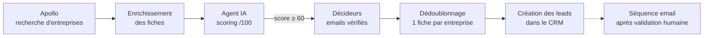

# ⚙️ N8N Workflows

> Une sélection de mes workflows n8n, construits pour des cas réels en entreprise, puis nettoyés de toute donnée sensible pour pouvoir être réutilisés.

**Auteur :** [Mourad AMOUSSA](https://mourad2511.github.io) · AI & Automation Engineer
**Contexte :** ces workflows viennent de mon alternance chez Ekstere (vélos reconditionnés, 3 sites, 50 000 références), où mes automatisations font gagner **40 à 50 heures par semaine** aux équipes, avec **100 % d'adoption**.

---

## 📂 Contenu

| Workflow | Ce qu'il fait | Nœuds |
|:--|:--|:--:|
| **Prospection B2B (Apollo + IA + CRM)** | Recherche d'entreprises, enrichissement, scoring IA sur 100 selon une grille métier, recherche des décideurs, création des fiches dans le CRM | 19 |
| *(ajoute ici les autres workflows du dépôt)* | | |

---

## 🔍 Exemple : prospection B2B

- **Scoring par IA** : l'agent note chaque entreprise sur 6 critères métier et justifie sa note. Seules les entreprises à 60 ou plus continuent.
- **Qualité des données** : seuls les emails vérifiés sont gardés, et les doublons sont fusionnés.
- **Contrôle humain** : l'inscription aux séquences email reste désactivée tant qu'un commercial n'a pas validé les leads.

---

## 🚀 Importer un workflow dans n8n

1. Télécharge le fichier `.json` du workflow.
2. Dans n8n, clique sur **Workflows → Import from File** et choisis le fichier.
3. Recrée tes propres identifiants (**Credentials**) : clés OpenAI, Apollo, CRM, Google… Aucun identifiant n'est fourni dans ce dépôt.
4. Remplace les valeurs marquées `A_REMPLACER` (identifiants de séquence, adresse d'envoi…).
5. Lance d'abord le workflow avec le nœud **Limite test** pour vérifier le résultat sur quelques éléments.

---

## 🔒 Données et sécurité

- Les exports ne contiennent **aucun mot de passe, token ni clé API**.
- Les données de test (noms, emails de prospects) ont été **supprimées**.
- Les identifiants sont gérés dans les Credentials de n8n, jamais en dur dans les nœuds.

---

## 🧰 Stack

`n8n` · `JavaScript` · `OpenAI` · `Gemini` · `Apollo` · `Close CRM` · `API REST` · `Google Workspace`

📬 [Portfolio](https://mourad2511.github.io) · [LinkedIn](https://www.linkedin.com/in/mourad-amoussa) · mourad1.amoussa@outlook.com
